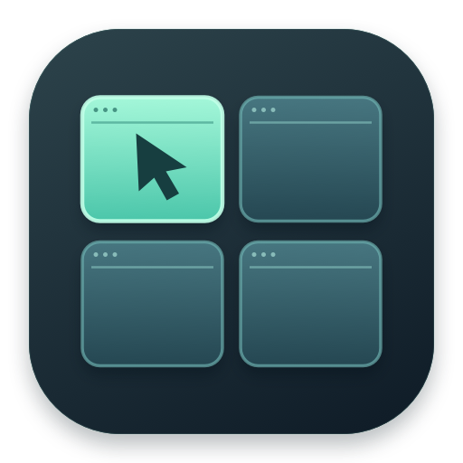
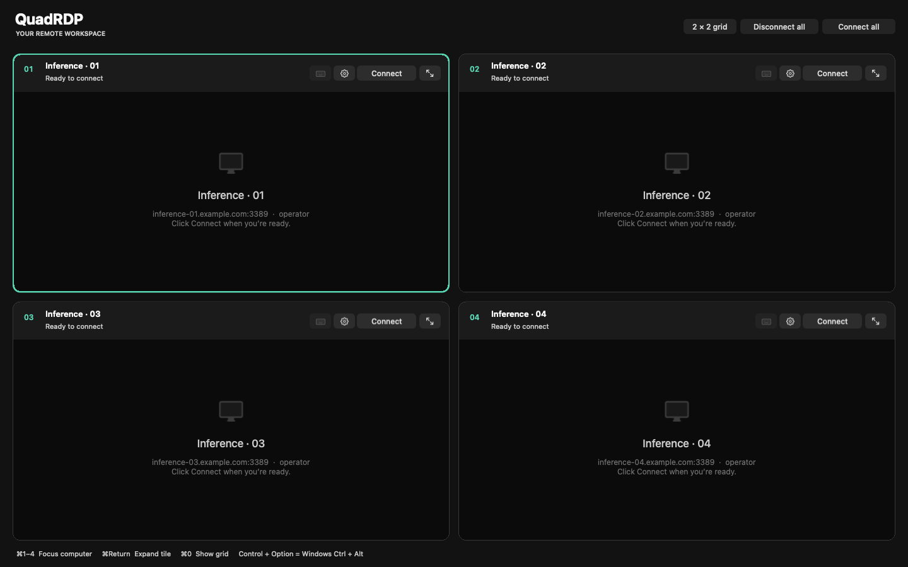
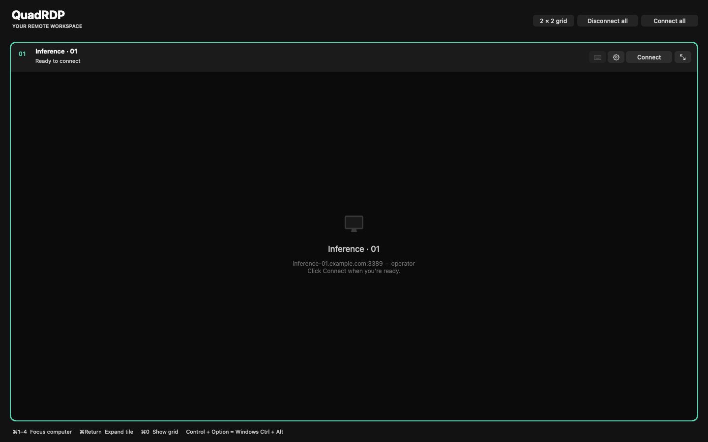

<p align="center">
  
</p>
<h1 align="center">QuadRDP</h1>
<p align="center"><strong>Four inference servers. One click. One window.</strong></p>
<p align="center">A small, native macOS home for your remote desktops.<br>Built with AppKit and FreeRDP 3.</p>



## Why I built it

I wanted a simple point-and-click way to connect to my four inference servers and see them all on one screen. Sit down at the Mac, click a button, and have the whole lab in front of me: model runners, terminals, logs, and the occasional service that needs a nudge.

That became **QuadRDP**. Configure four machines once, save their credentials in macOS Keychain, and hit **Connect all**. It starts all four RDP connections and keeps their desktops inside a single 2 × 2 workspace. When one machine needs your attention, expand its tile; when you’re done, return to the grid.

A little control room for the inference lab. Built around the button I actually wanted to click.

> **The one-click part:** Connect all starts the configured sessions. Password, Keychain, or certificate prompts can still need your attention. Connections start when you click; automatic connection on launch and automatic reconnect are not implemented.

## The workflow

**Configure once → Connect all → Click a desktop → Expand when needed → Back to the grid.**

| Feature | What it does |
| --- | --- |
| Four embedded desktops | Four independent FreeRDP sessions inside one native window |
| One Connect all button | Starts every configured connection |
| Grid and focus views | Expand one tile while the other sessions remain connected |
| Saved profiles | Remember names, hosts, ports, accounts, security settings, and resolution |
| macOS Keychain | Store passwords outside the profile JSON |
| Certificate decisions | Inspect certificates and choose one-time or remembered trust |
| Keyboard and mouse | Route input to the selected desktop, including remote cursors and Ctrl+Alt+Delete |

## A closer look

### The whole lab

The 2 × 2 grid gives each server a fixed place, its own controls, and a visible connection state.


### One server, more room

Use the expand button or **⌘Return** to give the selected desktop the workspace. **⌘0** brings the grid back. Switching views does not reconnect the sessions.



*These UI screenshots are rendered from the app’s native AppKit views with example profiles. They show the configured, disconnected state; no live server desktops or credentials are pictured.*

## Get running

You’ll need a Mac, Xcode or its command-line tools, Homebrew, and four reachable computers with RDP hosting configured. You can also start with fewer than four configured tiles.

```sh
brew install freerdp pkg-config
git clone https://github.com/sw30labs/QuadRDP.git
cd QuadRDP
./run.command
```

`run.command` builds and opens the app. After the first build, open `build/QuadRDP.app` directly whenever you want to use it.

1. **Add your machines.** Click the gear in each tile and enter its name, hostname or IP address, port, and RDP username.
2. **Save the login.** Passwords entered in the editor go into macOS Keychain. For Windows, use the account password rather than a Windows Hello PIN. Leave the password empty to keep an existing saved password or be prompted when connecting.
3. **Choose security and resolution.** Keep Network Level Authentication for hosts that support it. TLS-only mode is available for servers configured without NLA. Choose the remote desktop resolution; QuadRDP scales it to fit the tile.
4. **Click Connect all.** Inspect any certificate prompt. Connect Once permits this connection without saving trust; Trust Certificate remembers the decision. A changed certificate requires a new decision.

The RDP servers must be reachable from your Mac, directly or through your existing VPN. QuadRDP connects to their desktops; your inference tools run on those computers.

## Shortcuts

| Action | Control |
| --- | --- |
| Focus a computer | Click its desktop, or ⌘1–4 |
| Expand / restore selected tile | ⌘Return, or the expand button |
| Return to the grid | ⌘0, or **2 × 2 grid** |
| Configure selected computer | ⌘, or the gear |
| Send Ctrl+Alt+Delete | The keyboard button in the tile header |
| Full screen | Green window button, or Control-⌘F |
| Disconnect | Tile button or **Disconnect all** |

Control maps to Windows Ctrl, Option to Alt, and Command to the Windows key. The app reserves ⌘0–4, ⌘Return, ⌘,, and ⌘Q. Use Ctrl+C/V within the remote desktop. Keys and mouse buttons are released when focus leaves a tile or the app.

## Build and verify

```sh
bash scripts/build.sh
bash scripts/test.sh
```

The local build links to your Homebrew libraries and is ad-hoc signed. The deployment target defaults to the current macOS major version to match those dependencies. Rebuild after an incompatible FreeRDP upgrade. A portable distribution would need bundled libraries and Developer ID signing/notarization; this repository currently provides source builds.

The test harness uses four FreeRDP server peers over in-process socket pairs. It performs real TLS/RDP handshakes, checks decoded pixels and isolated keyboard/mouse input, and exercises reconnect, certificate rejection and persistence, certificate changes, and cancellation. It also checks profile persistence, corrupt-file handling, permissions, key mapping, coordinate scaling, and image creation. It needs no Windows credentials or listening ports. Temporary profiles and test certificates stay under ignored `build/test-data`; tests create no Keychain items.

The native UI has been checked for layout, form validation, focus shortcuts, and expand/restore. A real Windows NLA login and the Mac Keychain permission flow still need end-to-end verification with actual hosts and accounts.

To regenerate the documentation images and app icon:

```sh
bash scripts/screenshots.sh
swift -module-cache-path build/ModuleCache scripts/make-icon.swift
```

The screenshot renderer uses example profiles and does not connect to servers or load saved user profiles.

## Where things live

| Data | Location |
| --- | --- |
| Profiles | `~/Library/Application Support/QuadRDP/profiles.json` — owner-only permissions, no passwords |
| Passwords | macOS Keychain, service `local.quadrdp.password` |
| Trusted certificates | `~/Library/Application Support/QuadRDP/freerdp/` |
| Build and test output | `build/` — ignored by Git |

Keychain entries are tied to the profile and connection identity. Changing the host, port, domain, or username uses a different entry. For isolated development profiles and certificate storage, set `QUADRDP_DATA_DIR`; that does not change the Keychain service.

## Under the hood

- `QDApp.m` manages the native window, tiles, menus, and connection dialogs.
- `QDSession.m` owns a FreeRDP instance and worker per connection. It handles frames, certificates, remote cursors, and the synchronized input queue. Protocol work stays off the main thread.
- `QDDesktopView.m` draws each desktop and routes input. Only the newest frame is retained; the UI refreshes at 30 Hz.
- `QDProfile.m` handles profile JSON and Keychain storage.

## Current scope

This version covers desktop display, physical keyboard input, mouse buttons and wheel, and remote cursors. The keyboard mapping is initially US. Clipboard synchronization, audio, file/drive redirection, RD Gateway, smart cards, Entra web authentication, IME/alternate keyboard layouts, automatic reconnect, and dynamic server-resolution changes are not implemented. Rendering uses FreeRDP’s software path; the H.264 graphics pipeline is not enabled.

[FreeRDP](https://github.com/FreeRDP/FreeRDP) is an external dependency licensed under Apache 2.0.
